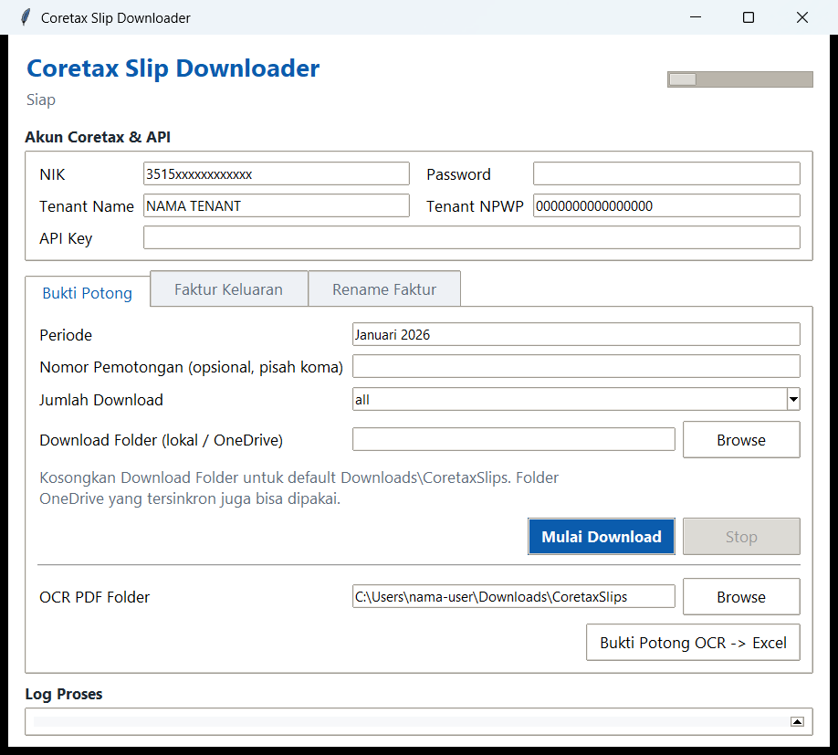
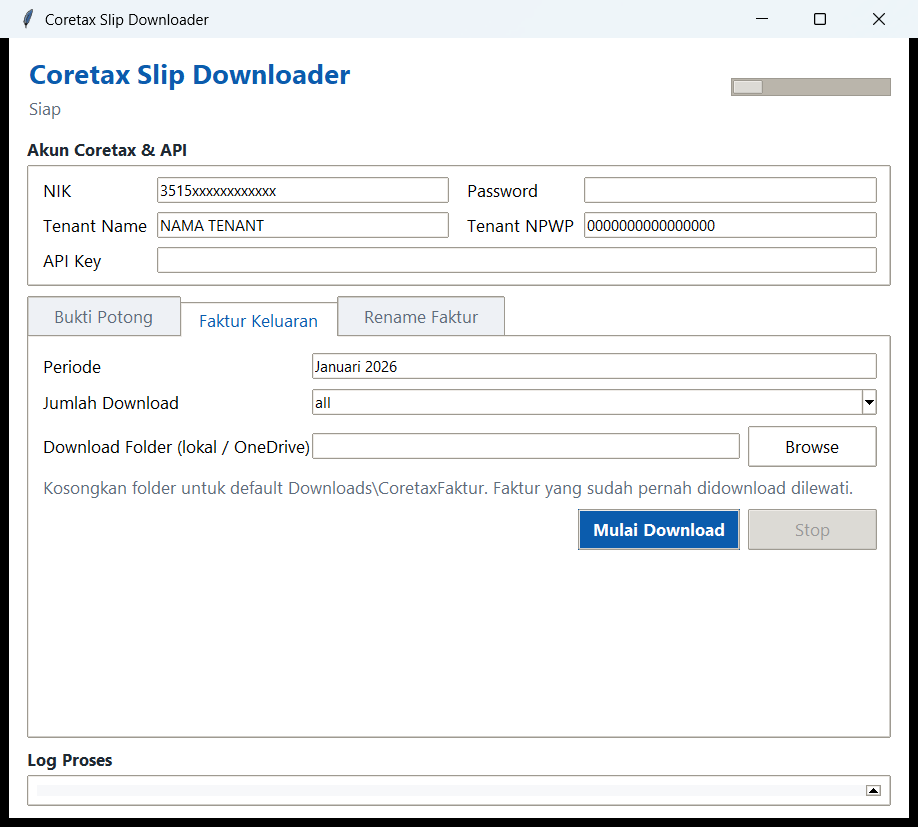
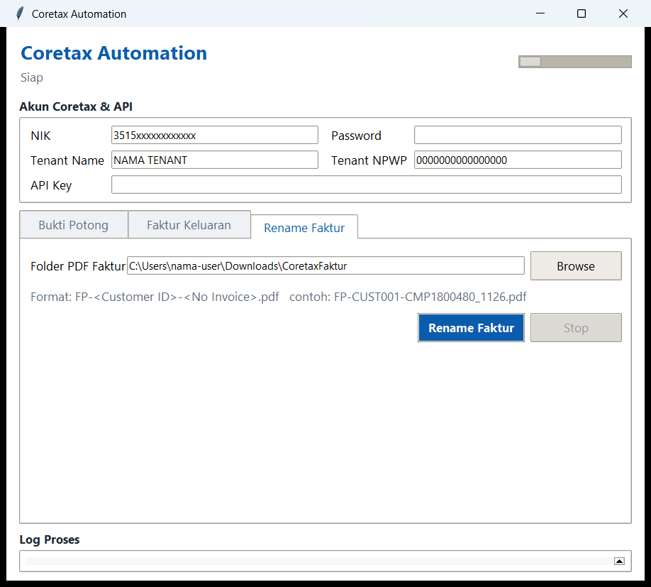

<div align="center">

# Coretax Slip Downloader

**Download bukti potong & faktur pajak keluaran dari Coretax DJP secara otomatis, lalu rename faktur sesuai Customer ID.**


[](../../releases/latest)

<br>

<table>
  <tr>
    <td align="center"><br><sub><b>Bukti Potong</b></sub></td>
    <td align="center"><br><sub><b>Faktur Keluaran</b></sub></td>
    <td align="center"><br><sub><b>Rename Faktur</b></sub></td>
  </tr>
</table>

</div>

## Fitur

| | Fitur | Keterangan |
|---|---|---|
| 🧾 | **Bukti Potong** | Download PDF eBupot per periode, semua atau nomor tertentu |
| 📄 | **Faktur Keluaran** | Download PDF Faktur Pajak Keluaran (e-Faktur > Pajak Keluaran) per masa dan tahun |
| 🏷️ | **Rename Faktur** | Ganti nama jadi `FP-<Customer ID>-<No Invoice>.pdf` |
| 📊 | **OCR ke Excel** | Ubah folder PDF bukti potong jadi Excel lewat server OCR |
| ⏭️ | **Skip duplikat** | File yang sudah pernah didownload dilewati otomatis |
| ⏹️ | **Stop** | Hentikan proses kapan saja (selesai setelah item yang sedang berjalan) |

## Cara Pakai

Tidak perlu install Python. Yang dibutuhkan hanya **Windows** dan **Google Chrome**.

### 1. Install

1. Buka [Releases](../../releases/latest), download `CoretaxSlip-vX.Y.Z-windows.zip`.
2. Klik kanan zip, **Extract All**, simpan ke folder yang mudah dibuka (contoh `C:\CoretaxSlip`).
3. Double click **`CoretaxSlip.exe`**.
4. Jika muncul peringatan Windows "protected your PC": klik **More info**, lalu **Run anyway**.

> [!WARNING]
> `config.json` di folder aplikasi menyimpan isian form, **termasuk password**. Jangan dibagikan ke orang lain.

### 2. Isi data akun (sekali, di bagian atas)

Panel **Akun Coretax & API** dipakai oleh semua tab.

| Kolom | Isi |
|---|---|
| NIK, Password | Akun login Coretax |
| Tenant Name, Tenant NPWP | Nama dan NPWP perusahaan yang dipilih saat login |
| API Key | Hanya untuk OCR dan Rename Faktur |

Alamat server OCR dan service customer tidak tampil di form. Isi `ocr_api_url` dan `customer_api_url` di `config.json` satu kali sebelum memakai OCR atau Rename Faktur.

### 3. Pilih tab sesuai kebutuhan

<details open>
<summary><b>🧾 Download Bukti Potong</b></summary>

1. Isi **Periode**, contoh `Januari 2026`.
2. Kosongkan **Nomor Pemotongan** untuk download semua, atau isi satu/lebih nomor dipisah koma.
3. Pilih **Jumlah Download** (`all`, 50, 100, 200, 500).
4. Pilih **Download Folder**, atau kosongkan untuk `Downloads\CoretaxSlips`.
5. Klik **Mulai Download**. Chrome terbuka dan login otomatis; jangan ditutup sampai selesai.
6. Selesai ditandai popup. **Stop** menghentikan proses setelah download yang sedang berjalan selesai.

</details>

<details open>
<summary><b>📄 Download Faktur Pajak Keluaran</b></summary>

1. Isi **Periode** (bulan dan tahun faktur) dan **Jumlah Download**.
2. Pilih **Download Folder**, atau kosongkan untuk `Downloads\CoretaxFaktur`.
3. Klik **Mulai Download**. Aplikasi membuka e-Faktur > Pajak Keluaran, menekan Refresh, lalu mendownload PDF tiap faktur.
4. Faktur yang sudah pernah didownload dan baris draft tanpa nomor faktur dilewati otomatis.

</details>

<details open>
<summary><b>🏷️ Rename Faktur</b></summary>

1. Pastikan **API Key** terisi dan `customer_api_url` sudah diisi di `config.json`.
2. Pilih **Folder PDF Faktur** (otomatis terisi folder download faktur).
3. Klik **Rename Faktur**. Hasil: `FP-<Customer ID>-<No Invoice>.pdf`.
4. File yang gagal (data tidak terbaca, customer tidak ditemukan, atau NPWP cocok ke beberapa customer) tidak diubah dan ditampilkan di popup.

</details>

<details open>
<summary><b>📊 OCR bukti potong ke Excel</b></summary>

1. Pilih **OCR PDF Folder** berisi PDF bukti potong, pastikan **API Key** terisi.
2. Klik **Bukti Potong OCR -> Excel**. File `.xlsm` dibuat di folder PDF tersebut.

</details>

### Kalau ada masalah

- Lihat kotak **Log Proses** di bagian bawah aplikasi.
- Password salah: perbaiki di form lalu coba lagi.
- Chrome harus terpasang dan tidak ditutup selama proses.

---

## Detail Fitur

<details>
<summary><b>Bukti Potong: format periode & nomor pemotongan</b></summary>

Format periode:

```text
Agustus 2026
```

Jika `Nomor Pemotongan` dikosongkan, aplikasi download semua bukti potong untuk bulan dan tahun yang dipilih. Jika diisi, aplikasi filter tabel per nomor lalu download hasil yang cocok. Contoh lebih dari satu nomor:

```text
1234567890, 0987654321, 1122334455
```

Nomor dicari satu per satu. Nomor yang tidak ada di periode tersebut dicatat di log dan muncul di popup `Nomor Pemotongan tidak ditemukan` saat proses selesai.

</details>

<details>
<summary><b>Download Folder & OneDrive</b></summary>

Hasil default tersimpan di `Downloads\CoretaxSlips` (bukti potong) dan `Downloads\CoretaxFaktur` (faktur).

`Download Folder` menerima folder lokal maupun folder OneDrive yang sudah tersinkron di komputer, jadi hasil download bisa langsung ikut sync. Tombol `Browse` otomatis membuka folder OneDrive kalau ada. Variable juga boleh dipakai:

```text
%OneDrive%\Finance\BuktiPotong
```

Link web OneDrive/SharePoint (`https://...`) **tidak bisa** dipakai. Buka OneDrive di File Explorer, lalu copy path folder lokalnya.

</details>

<details>
<summary><b>Skip download duplikat</b></summary>

Aplikasi melewati item yang sudah pernah didownload berdasarkan:

- history di file `.downloaded_slips.json` dalam folder download
- file PDF existing yang namanya mengandung nomor dokumen

Jika folder download diganti, history skip ikut bergantung ke folder baru itu.

</details>

<details>
<summary><b>OCR PDF ke Excel (API)</b></summary>

OCR dijalankan lewat server OCR yang kamu sediakan sendiri. Isi `ocr_api_url` di `config.json`; fitur OCR tidak jalan kalau kosong.

```text
POST /api/v1/ocr/api-key/download-excel
x-api-key: <api_key>
```

</details>

<details>
<summary><b>Rename Faktur: aturan dan API customer</b></summary>

Format nama:

```text
FP-<Customer ID>-<No Invoice>.pdf
```

- NPWP pembeli, nama pembeli, dan `Referensi` (No Invoice) dibaca langsung dari teks PDF.
- Customer ID (angka `id`) diambil dari service customer berdasarkan NPWP pembeli, memakai `API Key` yang sama dengan OCR (URL-nya berbeda).
- Karakter yang tidak boleh di nama file (`/ \ : * ? " < > |`) dan spasi diganti `_`. Contoh `CMP1800480/1126` jadi `CMP1800480_1126`.
- File berawalan `FP-` dilewati. Nama bentrok diberi akhiran `_2`, `_3`, ...
- File yang gagal tidak diubah dan muncul di popup.

Isi `customer_api_url` (base URL service customer) di `config.json`. Aplikasi memanggil:

```text
GET <customer_api_url>/external/coretax/by-npwp?npwp=<npwp>
APIKEY: <API Key>
```

Jika satu NPWP cocok ke beberapa customer:

1. Hanya 1 customer: dipakai.
2. Lebih dari 1: hanya yang berstatus `active`. Tinggal 1: dipakai.
3. Masih lebih dari 1: pilih yang namanya paling mirip dengan nama pembeli di faktur (PT/CV/tanda baca diabaikan), hanya kalau jelas unggul.
4. Tidak bisa dipastikan: file tidak di-rename dan muncul di popup beserta kandidatnya.

</details>

<details>
<summary><b>Konfigurasi (<code>config.json</code>)</b></summary>

File dibuat otomatis dari `config.template.json` dan disimpan setiap form diisi.

| Key | Fungsi |
|---|---|
| `nik`, `password` | Akun login Coretax |
| `tenant_name`, `tenant_npwp` | Tenant yang dipilih setelah login |
| `target_period`, `faktur_period` | Periode terakhir yang dipakai |
| `download_dir`, `faktur_download_dir` | Folder hasil download (kosong = default) |
| `api_key` | Dipakai OCR dan Rename Faktur |
| `ocr_api_url` | Base URL server OCR |
| `customer_api_url` | Base URL service customer |
| `browser_headless` | Selalu `false` (login butuh browser tampil) |

</details>

---

## Untuk Developer: Build `.exe`

Build harus dari **Windows** (bukan WSL) supaya hasilnya benar-benar `.exe`.

Kebutuhan: Python 3 Windows dari python.org (centang "Add Python to PATH"), Google Chrome, dan internet saat build pertama.

```bat
build_windows.bat
```

Hasil build ada di `finance-release\CoretaxSlip`. Zip folder itu untuk dibagikan.

Jalankan dari source:

```bat
py -3 -m venv venv
venv\Scripts\pip install -r requirements.txt
venv\Scripts\python gui.py
```

Struktur singkat:

- `gui.py`: tampilan Tkinter (tab, form, log)
- `main.py`: alur login lalu download (mode `bupot` / `faktur`)
- `services/`: login, navigasi Coretax, download, OCR, rename
- `build_windows.bat`: build `.exe` dengan PyInstaller

## Catatan

- Jangan bagikan `config.json` yang sudah berisi password.
- Jangan kirim source ke pengguna akhir; cukup zip hasil build atau halaman Release.
- Jika build gagal karena `py` tidak dikenali, install ulang Python Windows dan centang "Add Python to PATH".
- Aplikasi butuh Chrome karena login Coretax memakai browser.
